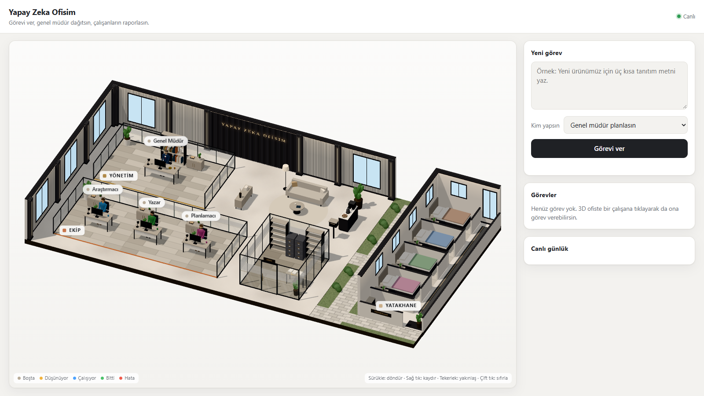

# Kendi Yapay Zeka Ofisini Kur



Ben bir mobilyacıyım. Atölyede çalışırken bir yandan da yapay zekayla aktif olarak uğraşıyor, her gün yeni bir şey öğreniyorum. Kendi işim için Claude, Codex ve Gemini'den oluşan bir yapay zeka ofisi kurdum. Bu depo onun sade, herkesin kendi bilgisayarına kurabileceği hâli. Öğrendiklerimi burada sizinle paylaşıyorum.

## Ne kurulur?

- **Kendi adlı çalışanlar:** Çalışanlarının adını, rolünü ve işini sen belirlersin. Araştırmacı, metin yazarı, planlamacı, ne istersen.
- **İstediğin kadar:** 1 ile 15 arasında çalışan. Başlarında bir genel müdür, verdiğin görevi uygun çalışanlara dağıtır.
- **3D ofis:** Ofisini tarayıcıda 3D görürsün. Kim çalışıyor, kim bitirdi, canlı izlersin; bir çalışana tıklayıp doğrudan ona görev verirsin.

Görevi yazarsın, genel müdür planlar, çalışanlar sırayla yapar ve her biri raporunu kendi klasörüne yazar.

## Gerekenler

- **Node.js 20 ya da üstü:** [nodejs.org](https://nodejs.org) adresinden LTS sürümü.
- **Claude Code ve bir Claude aboneliği (Pro ya da Max):** Kurulum `npm install -g @anthropic-ai/claude-code`, sonra terminalde `claude` yazıp hesabınla giriş yap.
- **Git:** [git-scm.com](https://git-scm.com). Yoksa depoyu zip olarak da indirebilirsin.

Ek ücret yok: çalışanlar senin Claude aboneliğinle çalışır, API anahtarı kullanmaz. Hiçbir paket de kurulmaz; Node'un kendisi yeter.

## En kolay kurulum: Claude Code'a yaptır

Boş bir klasör aç (örneğin `C:\ofisim` ya da `~/ofisim`), o klasörde terminali açıp `claude` yaz ve şunu yapıştır:

```text
Şu adresteki kurulum talimatını oku ve adım adım uygula:
https://raw.githubusercontent.com/yapayzekaofisi/kendi-ofisini-kur/main/KURULUM-TALIMATI.md
Soruları bana tek tek sor; ofisimi benim cevaplarıma göre kur.
```

Claude sana ofisinin adını, kaç çalışan istediğini ve her birinin ne iş yapacağını soracak, sonra her şeyi kurup ofisini açacak. Talimatın tamamı: [KURULUM-TALIMATI.md](KURULUM-TALIMATI.md).

## Elle kurulum

```bash
git clone https://github.com/yapayzekaofisi/kendi-ofisini-kur
cd kendi-ofisini-kur/baslangic-ofisi
# ofis.ayar.json dosyasını kendi ofisine göre düzenle
npm run kur
npm test
npm start
```

Sonra tarayıcıda `http://127.0.0.1:4800` adresini aç. Terminal açık kaldıkça ofis açıktır; kapatmak için `Ctrl+C`.

### ofis.ayar.json

| Alan | Ne işe yarar |
|---|---|
| `ofisAdi` | Ofisin adı, 3D tabelada da yazar (en çok 40 harf). |
| `patron` | Çalışanların sana nasıl hitap edeceği. |
| `calisanlar` | Çalışan listesi (1-15). Her biri: `ad`, `rol`, `is` (ne iş yaptığı), istersen `web: true` (internette arama), `ekip` (aynı ekiptekiler aynı odada oturur). |
| `model` | `sonnet` (varsayılan), daha hafif iş için `haiku`, daha ağır iş için `opus`. |
| `mesai` | Mesai saatleri, örneğin `{"baslangic":"09:00","bitis":"18:00"}`. Mesai dışında boştaki çalışanlar yatakhaneye gider. |
| `port`, `host` | Varsayılan `4800` ve `127.0.0.1` (sadece bu bilgisayar). |

Ayara yeni bir çalışan ekleyip ofisi yeniden başlatınca klasörü ve iş tanımı kendiliğinden açılır. Her çalışanın iş tanımı `calisanlar/<çalışan>/CLAUDE.md` dosyasındadır; işine göre zenginleştirebilirsin.

## Nasıl çalışır?

- "Genel müdür planlasın" dersen genel müdür işi en çok 5 adıma böler; bir adımın raporu bir sonraki çalışana geçer.
- Bir çalışana doğrudan da görev verebilirsin: listeden seç ya da 3D ofiste ona tıkla.
- Görevler sırayla, tek tek çalışır. Böylece aboneliğinin limiti bir anda tükenmez.
- Raporlar `calisanlar/<çalışan>/raporlar/<tarih>-gorev-<no>/rapor.md` dosyasına yazılır; panelde "Raporu aç" ile okunur.
- Çalışanlar sadece kendi klasörlerinde dosya okuyup yazar. Komut çalıştıramaz, bir şey yayınlayamaz, mesaj ya da e-posta gönderemez; böyle bir iş gerekirse taslağını hazırlayıp "onay gerekiyor" yazar.

## Rehber

- [Buluta taşıma](rehber/1-buluta-tasima.md): Bilgisayarın kapalıyken de ofisin çalışsın.
- [Telefondan erişim](rehber/2-telefondan-erisim.md): Ofisini telefonundan güvenle yönet.
- [Codex ve Gemini](rehber/3-codex-ve-gemini.md): Bir çalışanı Codex ile çalıştırmak, Gemini'yi nerede kullanmak.
- [Token ve limitler](rehber/4-token-ve-limitler.md): Abonelik limitini verimli kullanmak.
- [Güvenlik](rehber/5-guvenlik.md): Çalışanlar neyi yapabilir, neyi yapamaz.

## Video

Adım adım anlattığım video YouTube kanalımda: [youtube.com/@yapayzekaofisi](https://www.youtube.com/@yapayzekaofisi). Kısa videolar Instagram'da: [@yapay_zekaofisi](https://www.instagram.com/yapay_zekaofisi).

Mobilya işlerim: Koç Deco ([instagram.com/kocdeco](https://www.instagram.com/kocdeco))

## Lisans

MIT, ayrıntı [LICENSE](LICENSE) dosyasında. `baslangic-ofisi/public/vendor/` altındaki three.js dosyaları three.js yazarlarına aittir (MIT). Bu proje Anthropic, OpenAI ya da Google ile bağlantılı değildir.
